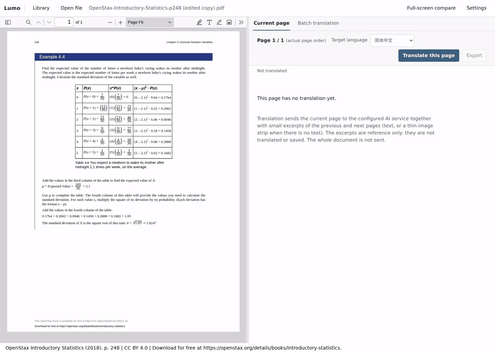

<h1 align="center"></h1>

A local PDF and EPUB reader that translates pages with a vision model: a PDF page, or the page on screen in an EPUB. Each request also carries short excerpts of the neighbouring pages for continuity; they are reference only and never translated or saved. Each page becomes a standalone Typst document (headings, lists, tables, formulas, diagrams, kept images or explicit placeholders) that keeps the source's columns, table structure, colours and bold/italic emphasis where the model can read them, saved in SQLite and rendered in the app. A document that does not compile locally goes back to the model, round after round, until it compiles or you cancel (this can incur charges), and the page panel shows the diagnostics and changed lines of the latest five rounds. If a PDF has no usable outline, Lumo can generate one with the same vision model and use it to select page ranges for batch translation. EPUB has a contents panel built from its own table of contents, and reading settings for font size, typeface, line spacing and theme.

English · [简体中文](README.zh-CN.md)



The recording uses the current build with OpenAI GPT-6.1 Sol at low reasoning effort, translating one page from English to Simplified Chinese. The Typst source streams in as the model writes it; Lumo then validates and saves it and shows the compiled preview. The generation phase is played at 2–3× speed, so the animation does not show real latency (this run took about 26 s from click to preview). [Example PDF](docs/assets/page-generation-demo.pdf) is the page used.

The page is p. 248 of [*Introductory Statistics*](https://openstax.org/details/books/introductory-statistics) by Barbara Illowsky and Susan Dean (OpenStax, © 2018 Rice University), licensed [CC BY 4.0](https://creativecommons.org/licenses/by/4.0/) and not covered by this project's MIT license. It is a single-page excerpt with an added attribution footer. The translation was generated by Lumo with GPT-6.1 Sol and is not endorsed by the authors or OpenStax.

## Quick start

### Install

Download the file for your system from the [latest release](https://github.com/oOSomnus/lumo/releases/latest), check it against `SHA256SUMS`, and install it. Nothing else is needed: Bun, PDF.js, epub.js and the Typst runtime are inside, and the Windows installer carries the WebView2 runtime.

| System | Download | Requires |
| --- | --- | --- |
| Windows x64 | `lumo-v<version>-windows-x64-setup.exe` | Windows 10 1809 or newer |
| Windows ARM64 | `lumo-v<version>-windows-arm64-setup.exe` | Windows 11 |
| macOS Intel / Apple silicon | `lumo-v<version>-macos-x64.dmg` / `lumo-v<version>-macos-arm64.dmg` | macOS 13 or newer |
| Linux x64 / ARM64 | `lumo-v<version>-linux-<arch>.deb`, `.rpm` or `.AppImage` | A desktop session, a default web browser and WebKitGTK 4.1 (Ubuntu 22.04, Debian 12 or newer) |

- **Windows:** run the setup (per user, no administrator rights needed); start Lumo from the Start menu. Uninstall under Settings → Apps.
- **macOS:** open the DMG and drag `Lumo.app` onto Applications; start it from Applications or Launchpad. Uninstall by removing `Lumo.app`.
- **Linux:** `sudo apt install ./lumo-v<version>-linux-x64.deb` or `sudo dnf install ./lumo-v<version>-linux-x64.rpm` adds Lumo to the application menu; uninstall with the package manager. An AppImage needs `chmod +x` and then runs directly and adds no menu entry; without FUSE start it with `--appimage-extract-and-run`. Delete the file to remove it.

Lumo opens a small window with the local address and a plain-language activity log. **Open WebUI** opens the reader and translation interface in your default browser; **Copy access link** copies the full link including this run's access code, which only works on this computer and must not be shared. **Quit Lumo** (or closing the window) stops the local service and interrupts translations in progress, so Lumo asks first and you should save unsaved work in the browser beforehand. Starting Lumo a second time only brings the window forward.

Your library and credentials live in the [data directory](docs/manual.md#data-and-security) shown under **More logs and details**. Installing, upgrading and uninstalling never touch it, and an older, unsupported database is rejected without changes.

The installers are signed only when the release notes and `SIGNING.txt` say so; otherwise expect the system to warn you:

- **Windows (unsigned):** SmartScreen may show "Windows protected your PC". Choose **More info → Run anyway**. Devices governed by Smart App Control or an organisation policy may refuse unsigned apps outright; Lumo cannot change that.
- **macOS (ad-hoc signed, not notarized):** Gatekeeper blocks the first launch. Control-click `Lumo.app` and choose **Open**, or allow this one app under **System Settings → Privacy & Security → Open Anyway**. You do not need to turn Gatekeeper off.

### Run from source

Bun 1.4.2 or newer. The desktop window additionally needs Rust 1.90 or newer and the [Tauri system prerequisites](https://tauri.app/start/prerequisites/) for your OS.

```bash
bun install
bun run dev          # builds the server and opens the desktop window
bun run dev:server   # server only; no Rust needed
```

`bun run dev:server` prints a URL containing an access code, for example `http://127.0.0.1:12345/?token=...`. The server listens on `127.0.0.1` only, so open that URL in a browser on the same machine; the desktop window's **Open WebUI** button does the same. In **Settings** (the first **Translate** press opens it for you), pick a model that accepts image input, then add an API key or sign in with OAuth.

The first run downloads the pinned PDF.js viewer into `vendor/pdfjs/` and prepares the Typst runtime and fonts in `vendor/typst/`; archives are unpacked by the scripts themselves, so no `unzip` is needed. epub.js and JSZip are copied from `node_modules`.

PDF and EPUB files have no application-imposed limit on their total size; available memory and disk space still constrain large files. An EPUB package may hold at most 20,000 entries, and its container and package (OPF) XML files at most 2,097,152 characters each, counted as JavaScript string length rather than bytes.

Lumo opens on a bookshelf with a cover for each document: the first PDF page, or a generated EPUB card. Selecting a book resumes its saved PDF page or EPUB reading position and view; **Library** in the top bar returns to the shelf without ending the current session.

Panes can be arranged as left only, right only, equal split, or 60/40 either way with the buttons above them; ArrowLeft and ArrowRight turn pages from anywhere in the reader. Typst source is syntax-highlighted while it streams in, in the source view and in repair snippets. Touch screens get 44 px targets and a **Reading tools** menu in narrow viewers. Details: [docs/manual.md](docs/manual.md#reading-and-translation).

## Documentation

[docs/manual.md](docs/manual.md) covers [settings and credentials](docs/manual.md#settings), [reading and translation](docs/manual.md#reading-and-translation), the [desktop app and standalone server](docs/manual.md#desktop-app-and-standalone-server) and [data and security](docs/manual.md#data-and-security).

Credentials are stored in plaintext on this machine; protect backups.

## Development

```bash
bun run typecheck
bun test
bun run build                                   # installer for this machine, in src-tauri/target/<triple>/release/bundle/
cargo test --locked --manifest-path src-tauri/Cargo.toml   # after a build
bun scripts/smoke-desktop.ts                    # runs the built server the way the window does
```

`bun run build --target <triple>` builds another architecture of the same OS; `bun run build:server` builds only the standalone server in `dist/sidecar/`. CI builds all six targets (Windows, macOS, Linux × x64, ARM64) on native runners, and a `v*` tag drafts a release; see `.github/workflows/`.

Source layout and invariants: [AGENTS.md](AGENTS.md).

## License

[MIT](LICENSE) © 2026 Yihang Zhu. Bundled third-party components retain their own licenses; the installers and the release assets include `LICENSE` and `THIRD_PARTY_NOTICES.txt`.
