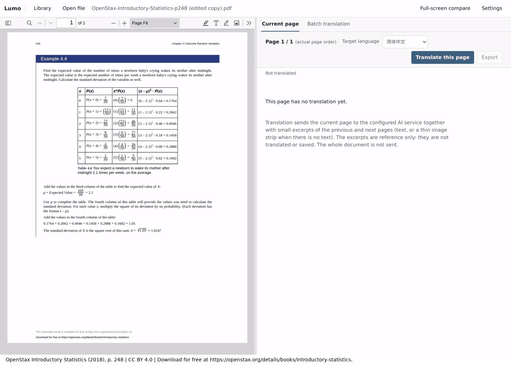

<h1 align="center"></h1>

本地 PDF / EPUB 阅读器，用视觉模型翻译每一页：PDF 的一页，或 EPUB 屏幕上正在显示的那一页。每次请求还会附带相邻页的简短摘录以保持上下文连贯，摘录只作参考，不会被翻译或保存。每页译文会生成为独立 Typst 文档（标题、列表、表格、公式、图形、保留的图片或明确的占位说明），在模型能看清时保留原文的分栏、表格结构、颜色和粗斜体，保存在本地 SQLite 中并在应用内渲染。无法通过本地编译的文档会自动发回模型修正，一轮接一轮，直到编译通过或你取消（可能产生费用），页面面板会显示最近五轮的诊断与改动的行。PDF 没有可用目录时，Lumo 可以用同一视觉模型生成目录，并按目录选择批量翻译的页码范围；EPUB 提供由自身目录生成的目录面板，以及字号、字体、行距和主题的阅读设置。

[English](README.md) · 简体中文



录制使用当前版本，模型为 OpenAI GPT-6.1 Sol（推理强度 low），把一页从英文翻译为简体中文。Typst 源码随模型输出流式显示；随后 Lumo 校验、保存，并显示编译后的预览。生成阶段按 2–3 倍速播放，因此动图不代表真实耗时（这次从点击到出现预览约 26 秒）。[示例 PDF](docs/assets/page-generation-demo.pdf) 即录制所用的页面。

该页是 [*Introductory Statistics*](https://openstax.org/details/books/introductory-statistics) 第 248 页，作者 Barbara Illowsky、Susan Dean（OpenStax，© 2018 Rice University），采用 [CC BY 4.0](https://creativecommons.org/licenses/by/4.0/) 许可，不在本项目 MIT 许可范围内。示例为单页摘录，并新增了署名页脚；译文由 Lumo 调用 GPT-6.1 Sol 生成，未获作者或 OpenStax 认可。

## 快速开始

### 安装

从[最新 Release](https://github.com/oOSomnus/lumo/releases/latest) 下载适合你系统的文件，用 `SHA256SUMS` 校验后安装。无需额外安装任何东西：Bun、PDF.js、epub.js 和 Typst 运行时已内置，Windows 安装包还附带 WebView2 运行时。

| 系统 | 下载 | 要求 |
| --- | --- | --- |
| Windows x64 | `lumo-v<版本>-windows-x64-setup.exe` | Windows 10 1809 或更新 |
| Windows ARM64 | `lumo-v<版本>-windows-arm64-setup.exe` | Windows 11 |
| macOS Intel / Apple 芯片 | `lumo-v<版本>-macos-x64.dmg` / `lumo-v<版本>-macos-arm64.dmg` | macOS 13 或更新 |
| Linux x64 / ARM64 | `lumo-v<版本>-linux-<架构>.deb`、`.rpm` 或 `.AppImage` | 桌面会话、默认网页浏览器和 WebKitGTK 4.1（Ubuntu 22.04、Debian 12 或更新） |

- **Windows：** 运行安装程序（按当前用户安装，不需要管理员权限），从开始菜单启动 Lumo。在“设置 → 应用”中卸载。
- **macOS：** 打开 DMG，把 `Lumo.app` 拖到“应用程序”，从“应用程序”或启动台打开。删除 `Lumo.app` 即卸载。
- **Linux：** `sudo apt install ./lumo-v<版本>-linux-x64.deb` 或 `sudo dnf install ./lumo-v<版本>-linux-x64.rpm` 会把 Lumo 加入应用菜单，用包管理器卸载。AppImage 先 `chmod +x` 再直接运行，不会添加菜单项；系统没有 FUSE 时用 `--appimage-extract-and-run` 启动。删除该文件即卸载。

Lumo 会打开一个小窗口，显示本地地址和通俗易懂的活动日志。**打开 WebUI** 在默认浏览器中打开阅读与翻译界面；**复制访问链接** 复制含本次访问码的完整链接，它只在本机有效，请勿分享。**退出 Lumo**（或关闭窗口）会停止本地服务并中断正在进行的翻译，因此 Lumo 会先请你确认，请事先在浏览器中保存未保存的内容。再次启动 Lumo 只会把已有窗口带到前台。

书库和凭证位于[数据目录](docs/manual.zh-CN.md#数据与安全)，可在“更多日志与详情”中看到。安装、升级和卸载都不会触碰它；较旧、不受支持的数据库会被拒绝且不做任何改动。

只有 Release 说明和 `SIGNING.txt` 明确写明时，安装包才经过签名；否则系统会给出提示：

- **Windows（未签名）：** SmartScreen 可能显示“Windows 已保护你的电脑”，选择 **更多信息 → 仍要运行**。由 Smart App Control 或组织策略管理的设备可能直接拒绝未签名应用，Lumo 无法改变这一点。
- **macOS（ad-hoc 签名，未公证）：** Gatekeeper 会阻止首次启动。按住 Control 点按 `Lumo.app` 选择 **打开**，或在 **系统设置 → 隐私与安全性** 中对这一个应用选择 **仍要打开**。无需关闭 Gatekeeper。

### 从源码运行

要求 Bun 1.4.2 或更新版本。桌面窗口还需要 Rust 1.90 或更新版本，以及所在系统的 [Tauri 系统依赖](https://tauri.app/start/prerequisites/)。

```bash
bun install
bun run dev          # 构建服务并打开桌面窗口
bun run dev:server   # 仅运行服务，不需要 Rust
```

`bun run dev:server` 会打印带访问码的地址，例如 `http://127.0.0.1:12345/?token=...`。服务只监听 `127.0.0.1`，请在同一台机器的浏览器中打开该地址；桌面窗口的“打开 WebUI”按钮效果相同。在“设置”中（第一次点击“翻译”时会自动为你打开）选择支持图像输入的模型，再配置 API key 或 OAuth 登录。

首次运行会把固定版本的 PDF.js viewer 下载到 `vendor/pdfjs/`，并在 `vendor/typst/` 准备 Typst 运行时与字体；压缩包由脚本自行解压，无需系统安装 `unzip`。epub.js 与 JSZip 从 `node_modules` 复制。

PDF 和 EPUB 文件的总大小不设应用层上限；大文件仍受可用内存和磁盘空间限制。EPUB 包最多包含 20,000 个条目，其 container 与包（OPF）XML 文件各自最多 2,097,152 个字符（按 JavaScript 字符串长度计数，不是字节数）。

Lumo 启动后先显示书架：PDF 使用首页作为封面，EPUB 使用生成的封面卡片。选择书籍会恢复上次的 PDF 页码或 EPUB 阅读位置与视图；顶栏的“书库”可返回书架，当前会话不会结束。

用窗格上方的按钮可以把两栏排成仅左侧、仅右侧、均分，或任一侧 60/40；左右方向键可在阅读器的任何位置翻页。Typst 源码在流式生成时、源码视图中和修复片段里都带语法高亮。触屏提供 44 px 的点按目标，窄 viewer 中还有“阅读工具”菜单。详见[手册](docs/manual.zh-CN.md#阅读与翻译)。

## 文档

[docs/manual.zh-CN.md](docs/manual.zh-CN.md) 涵盖[设置与凭证](docs/manual.zh-CN.md#设置)、[阅读与翻译](docs/manual.zh-CN.md#阅读与翻译)、[桌面应用与独立服务](docs/manual.zh-CN.md#桌面应用与独立服务)和[数据与安全](docs/manual.zh-CN.md#数据与安全)。

AI 凭证在本机明文保存，备份时请妥善保护。

## 开发

```bash
bun run typecheck
bun test
bun run build                                   # 构建本机安装包，位于 src-tauri/target/<triple>/release/bundle/
cargo test --locked --manifest-path src-tauri/Cargo.toml   # 构建之后运行
bun scripts/smoke-desktop.ts                    # 以桌面窗口的方式运行已构建的服务
```

`bun run build --target <triple>` 可构建同一操作系统的另一种架构；`bun run build:server` 只构建 `dist/sidecar/` 中的独立服务。CI 在原生 runner 上构建全部六个目标（Windows、macOS、Linux × x64、ARM64），`v*` 标签会生成 Release 草稿，见 `.github/workflows/`。

源码结构与约束见 [AGENTS.md](AGENTS.md)。

## 许可证

[MIT](LICENSE) © 2026 Yihang Zhu。内置的第三方组件保留各自的许可证，安装包和 Release 附件均含 `LICENSE` 与 `THIRD_PARTY_NOTICES.txt`。
