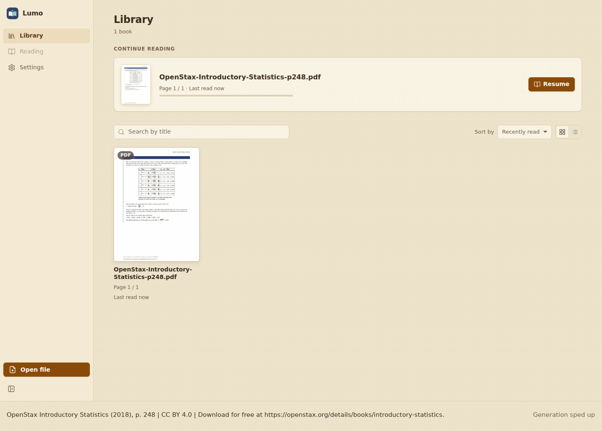

<h1 align="center"></h1>

本地 PDF / EPUB 阅读器，用视觉模型翻译页面。每页译文生成为独立 Typst 文档，保存在应用内并渲染；无法通过本地编译时，会发回模型修复直到通过。PDF 的译文可以导出为一个 PDF，可只含译文，也可在每页原文后接译文。阅读界面在本机运行，用浏览器打开，书库可搜索，可选浅色、深色、护眼或夜间主题。[翻译流程](docs/manual.zh-CN.md#概述)

[English](README.md) · 简体中文



画面中的译文是 GPT-6.1 Sol 为这一页生成的结果。录制时由本地的替身服务回放这份译文，没有调用 AI 服务，生成过程也经过加速，因此动图不代表真实耗时。

该页是 [*Introductory Statistics*](https://openstax.org/details/books/introductory-statistics) 第 248 页，作者 Barbara Illowsky、Susan Dean（OpenStax，© 2018 Rice University），采用 [CC BY 4.0](https://creativecommons.org/licenses/by/4.0/) 许可，不在本项目 MIT 许可范围内；示例为[单页摘录](docs/assets/page-generation-demo.pdf)，并新增了署名页脚。译文未获作者或 OpenStax 认可。

## 安装

从[最新 Release](https://github.com/oOSomnus/lumo/releases/latest) 下载适合你系统的文件，用 `SHA256SUMS` 校验后安装。无需额外安装任何东西：Bun、PDF.js、epub.js 和 Typst 运行时已内置，Windows 安装包还附带 WebView2 运行时。

| 系统 | 下载 | 要求 |
| --- | --- | --- |
| Windows x64 | `lumo-v<版本>-windows-x64-setup.exe` | Windows 10 1809 或更新 |
| Windows ARM64 | `lumo-v<版本>-windows-arm64-setup.exe` | Windows 11 |
| macOS Intel / Apple 芯片 | `lumo-v<版本>-macos-x64.dmg` / `lumo-v<版本>-macos-arm64.dmg` | macOS 13 或更新 |
| Linux x64 / ARM64 | `lumo-v<版本>-linux-<架构>.deb`、`.rpm` 或 `.AppImage` | 桌面会话、默认网页浏览器和 WebKitGTK 4.1（Ubuntu 22.04、Debian 12 或更新） |

各系统的安装步骤、更新方式，以及系统提示未签名时的处理：[docs/manual.zh-CN.md#安装](docs/manual.zh-CN.md#安装)。

## 从源码运行

要求 Bun 1.4.2 或更新版本。桌面窗口还需要 Rust 1.90 或更新版本，以及所在系统的 [Tauri 系统依赖](https://tauri.app/start/prerequisites/)。

```bash
bun install
bun run dev          # 构建服务并打开桌面窗口
bun run dev:server   # 仅运行服务，不需要 Rust
```

`bun run dev:server` 会打印带访问码的地址，例如 `http://127.0.0.1:12345/?token=...`。服务只监听 `127.0.0.1`，请在同一台机器的浏览器中打开该地址。在“设置”中（第一次点击“翻译”时会自动为你打开）选择支持图像输入的模型，再配置 API key 或 OAuth 登录。首次运行会下载的内容：[docs/manual.zh-CN.md#从源码构建](docs/manual.zh-CN.md#从源码构建)。上一版本 Lumo 的书库需要先升级一次：[docs/manual.zh-CN.md#数据与安全](docs/manual.zh-CN.md#数据与安全)。

## 文档

[docs/manual.zh-CN.md](docs/manual.zh-CN.md) 涵盖[安装](docs/manual.zh-CN.md#安装)、[设置与凭证](docs/manual.zh-CN.md#设置)、[阅读与翻译](docs/manual.zh-CN.md#阅读与翻译)、[桌面应用与独立服务](docs/manual.zh-CN.md#桌面应用与独立服务)、[从源码构建](docs/manual.zh-CN.md#从源码构建)和[数据与安全](docs/manual.zh-CN.md#数据与安全)。

AI 凭证在本机明文保存，备份时请妥善保护。

## 开发

```bash
bun run typecheck
bun test
bun run build                                   # 构建本机安装包，位于 src-tauri/target/<triple>/release/bundle/
cargo test --locked --manifest-path src-tauri/Cargo.toml   # 构建之后运行
bun scripts/smoke-desktop.ts                    # 以桌面窗口的方式运行已构建的服务
bun run test:e2e -- --project=source            # Playwright 端到端测试
```

`bun run build --target <triple>` 可构建同一操作系统的另一种架构；`bun run build:server` 只构建 `dist/sidecar/` 中的独立服务。端到端测试需要 Node 和 `bunx playwright install chromium`；`--project=standalone` 针对 `bun run build:server` 构建的服务运行。Pull request 和推送到 `main` 时，CI 在 Linux 上运行类型检查、单元测试、独立服务的冒烟测试，以及两个项目下的书库与 EPUB 端到端测试。`v*` 标签会在原生 runner 上构建全部六个目标（Windows、macOS、Linux × x64、ARM64）并生成 Release 草稿；也可以手动运行 Desktop builds 工作流，得到六个目标的未签名构建。见 `.github/workflows/`。

带应用内更新的 Release 构建需要在环境中提供 `LUMO_UPDATER_PUBLIC_KEY`、`TAURI_SIGNING_PRIVATE_KEY` 和 `TAURI_SIGNING_PRIVATE_KEY_PASSWORD`。Windows 与 macOS 代码签名各有一组变量，列在 `scripts/signing.ts` 中。任何一组只提供部分变量，构建都会失败。私钥、证书和密码是构建机密，不得提交，也不得暴露给启动器窗口。

源码结构与约束见 [AGENTS.md](AGENTS.md)。

## 许可证

[MIT](LICENSE) © 2026 Yihang Zhu。内置的第三方组件保留各自的许可证，安装包和 Release 附件均含 `LICENSE` 与 `THIRD_PARTY_NOTICES.txt`。
