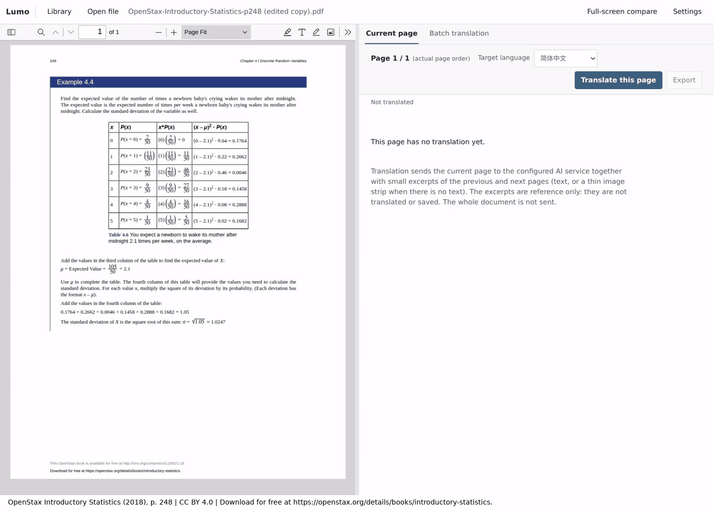

# Lumo manual

[README](../README.md) · [简体中文](manual.zh-CN.md)

## Overview

Lumo is a local PDF and EPUB reader that translates pages with a vision model: a PDF page, or the page on screen in an EPUB. Each request also carries short excerpts of the neighbouring pages for continuity; they are reference only and never translated or saved. Each page becomes a standalone Typst document (headings, lists, tables, formulas, diagrams, kept images or explicit placeholders) that keeps the source's columns, table structure, colours and bold/italic emphasis where the model can read them, saved in SQLite and rendered in the app. A document that does not compile locally goes back to the model, round after round, until it compiles or you cancel (this can incur charges), and the page panel shows the diagnostics and changed lines of the latest five rounds. If a PDF has no usable outline, Lumo can generate one with the same vision model and use it to select page ranges for batch translation. EPUB has a contents panel built from its own table of contents, and reading settings for font size, typeface, line spacing and theme.



The recording uses the current build with OpenAI GPT-6.1 Sol at low reasoning effort, translating one page from English to Simplified Chinese. The Typst source streams in as the model writes it; Lumo then validates and saves it and shows the compiled preview. The generation phase is played at 2–3× speed, so the animation does not show real latency (this run took about 26 s from click to preview). [Example PDF](assets/page-generation-demo.pdf) is the page used.

The page is p. 248 of [*Introductory Statistics*](https://openstax.org/details/books/introductory-statistics) by Barbara Illowsky and Susan Dean (OpenStax, © 2018 Rice University), licensed [CC BY 4.0](https://creativecommons.org/licenses/by/4.0/) and not covered by this project's MIT license. It is a single-page excerpt with an added attribution footer. The translation was generated by Lumo with GPT-6.1 Sol and is not endorsed by the authors or OpenStax.

## Install

Download the file for your system from the [latest release](https://github.com/oOSomnus/lumo/releases/latest), check it against `SHA256SUMS`, and install it. Nothing else is needed: Bun, PDF.js, epub.js and the Typst runtime are inside, and the Windows installer carries the WebView2 runtime.

| System | Download | Requires |
| --- | --- | --- |
| Windows x64 | `lumo-v<version>-windows-x64-setup.exe` | Windows 10 1809 or newer |
| Windows ARM64 | `lumo-v<version>-windows-arm64-setup.exe` | Windows 11 |
| macOS Intel / Apple silicon | `lumo-v<version>-macos-x64.dmg` / `lumo-v<version>-macos-arm64.dmg` | macOS 13 or newer |
| Linux x64 / ARM64 | `lumo-v<version>-linux-<arch>.deb`, `.rpm` or `.AppImage` | A desktop session, a default web browser and WebKitGTK 4.1 (Ubuntu 22.04, Debian 12 or newer) |

- **Windows:** run the setup (per user, no administrator rights needed); start Lumo from the Start menu. Uninstall under Settings → Apps.
- **macOS:** open the DMG and drag `Lumo.app` onto Applications; start it from Applications or Launchpad. Uninstall by removing `Lumo.app`.
- **Linux:** `sudo apt install ./lumo-v<version>-linux-x64.deb` or `sudo dnf install ./lumo-v<version>-linux-x64.rpm` adds Lumo to the application menu; uninstall with the package manager. An AppImage needs `chmod +x` and then runs directly and adds no menu entry; without FUSE start it with `--appimage-extract-and-run`. Delete the file to remove it.

The installers are signed only when the release notes and `SIGNING.txt` say so; otherwise expect the system to warn you:

- **Windows (unsigned):** SmartScreen may show "Windows protected your PC". Choose **More info → Run anyway**. Devices governed by Smart App Control or an organisation policy may refuse unsigned apps outright; Lumo cannot change that.
- **macOS (ad-hoc signed, not notarized):** Gatekeeper blocks the first launch. Control-click `Lumo.app` and choose **Open**, or allow this one app under **System Settings → Privacy & Security → Open Anyway**. You do not need to turn Gatekeeper off.

## Settings

Settings has one **AI provider and model** section, then the interface language and the data tools. A status line at the top of the AI section says where you stand: `Ready: <provider> · <model>`, not set up yet, saved but not finished (for example a credential is still missing), or that your current selection is not saved yet. **Save** is the primary button only while there is something to save, and **Done** closes the dialog once the saved setup is complete.

- **Interface language** — English or Simplified Chinese. Applying it reloads the page. The interface language is independent of the translation target language.
- **Provider and model** — only models that accept images are listed. Refresh the model list from the provider with **Refresh models**.
- **Reasoning effort** — optional, under **Advanced settings**, a fold that opens by itself when a saved value needs it (this one, or a built-in provider's endpoint override). The default leaves the provider and model behavior unchanged. The listed levels come from the selected model: `minimal`, `low`, `medium`, `high`, and, when the model supports them, `xhigh` and `max`. A model without reasoning support has no selectable level. Custom OpenAI-compatible endpoints offer `minimal` through `high`, but the endpoint must accept the setting; Lumo cannot verify that without a paid request.
- **Custom OpenAI-compatible** — enter the endpoint, context window and max tokens. A local endpoint may run without an API key.
- **Credentials** — store an API key or complete the provider's OAuth sign-in. Removing a credential signs out locally only; it does not revoke the token at the provider.
- **Amazon Bedrock and Google Vertex** — enter an API key (Bedrock bearer token or Google Cloud API key) in the app. AWS profiles, the default credential chain, Application Default Credentials, external credential files and credential-chain login are not offered.
- **Target language** — the translation language is separate from the interface language: Simplified Chinese, Traditional Chinese, English, Japanese, Korean, German, French or Spanish.

Settings are stored in the local database. Provider secrets exported in the shell are never used to configure a provider. Changing the model or reasoning effort does not rewrite saved translations; regenerate a page to apply the new choice. Each translation request pins the provider, model and effort active when it starts. Saving or opening Settings never sends a paid request.

Until a provider, model and credential are saved, **Translate this page** and the Batch panel's start button read **Configure AI to translate**. They open Settings instead of sending anything, and closing Settings leaves the page, the range and the language as they were. If the settings cannot be read, the same buttons read **Retry reading AI settings** instead of claiming that nothing is configured. A request that fails with an authentication or configuration error offers **Open AI settings**, and the raw error code stays under **Technical details**. Retrying the save of a draft, exporting, and reading saved translations never need the AI.

## Reading and translation

- Lumo opens on a bookshelf: each book shows a cover (the first PDF page or a generated EPUB card), its title, progress and last-read time. Selecting a book resumes its saved PDF page or EPUB reading position and view. **Library** in the top bar returns to the shelf without ending the session, so running translations, drafts and unsaved edits are kept.
- The official PDF.js viewer handles PDF rendering, outlines, thumbnails, text selection, forms, annotations and the native toolbar. EPUB files use epub.js with a **Contents** panel (the book's own table of contents, opened over the page), previous and next page buttons, reading settings (font size, typeface, line spacing, theme) and text selection. The active zoom or fit mode, rotation, scroll mode and spread mode belong to the open PDF, and an EPUB's reading settings and position belong to the open book: turning pages keeps them, changing a reading setting or resizing the window keeps you at the same place in the text, and reopening the book, reloading the page or restarting the server restores them.
- Specialised terms and proper nouns are glossed with the source spelling the first time they appear on each page, for example `费用（Expenses）`; later occurrences use the translation alone. Recognition depends on the selected model, and saved translations keep their original wording until regenerated.
- Layout and styling follow the source as far as the model can read them: columns and their relative widths, table rows, empty and merged cells, boxed groups, background fills, text colours and local bold or italic emphasis are rebuilt with native Typst grids, tables and text styling, never aligned with spaces. For a PDF the page image decides the layout; for an EPUB only the structure and inline styles in its XHTML exist. Only the bundled fonts are available, so a different source typeface is replaced by the closest one, colours are visual approximations, and saved translations keep their old layout until regenerated.
- Each PDF page, or each screen page of an EPUB, is translated into one standalone Typst document. The model uses headings, lists, tables, formulas, diagrams and `#image(...)` for extracted images; it inserts a visible labelled placeholder when a figure, chart or layout cannot be represented faithfully. Typst code is rendered locally; no network is used. If a newly generated document does not compile locally, Lumo sends the failing source and the compiler diagnostics (1-based line and column, with the reported line quoted and the reported range between ⟦ and ⟧) back to the model before saving, round after round, until it compiles or you press **Cancel this page**; the number of rounds is not limited. The model answers a correction with exact text replacements for the failing fragments, or with the complete document when much has to change, and Lumo applies them locally. A reply that cannot be applied (a replacement missing from the source or matching it more than once, or no change at all) gets a follow-up call that says why, after a pause of 1, 2, 4, 8, 16 and then 30 seconds for as long as consecutive replies leave the source as it was (a reply that changes the source starts the pauses over, and cancelling ends a pause at once); from the second round on, the request also tells the model what the previous reply changed, or why it was refused, so it does not repeat a change that did not help. Because there is no round limit, a page the model cannot fix keeps costing AI calls until you cancel, and it can incur charges. While this runs, the translation pane lists the latest five rounds (a note says how many earlier rounds are omitted; the run itself is not shortened): the diagnostics sent to the model, whether the reply replaced fragments or rewrote the document, the changed lines before and after, and whether the result compiled. Nothing is written to the database until the source compiles. If you cancel, or a request fails (a network, authentication, provider or timeout error), the page stays an unsaved draft and the previous translation is not overwritten; you can edit, export or discard the draft, and translating or regenerating that page is disabled while it exists. **Retry save** and saving an edit compile the draft again and never call the model. **Repair Typst** (**Continue repair** once rounds exist) starts a new repair from the latest draft: it calls the model only if the compiler still rejects the draft, then keeps going round after round until the draft compiles or you cancel, and it can incur charges again.
- **Neighbouring context** — a sentence often continues across a page break, so each request also carries a short excerpt from the end of the previous page and from the start of the next one (up to 2,000 characters of text each; for a PDF page without a text layer, a thin image strip instead). The excerpts are reference only: the model is told not to translate them, and only the current page's translation is saved. If a neighbouring page cannot be read, the page is still translated with less context and the page panel says so. A repair round sends no page source and no excerpts.
- **Preview and source** — the right pane switches between the rendered translation and the editable Typst source. The preview always fills the width of the right pane and scales the whole page with it. Typst source shown read-only is syntax-highlighted: the incoming source under **Live Typst source** while a page is generated, the **Source** view, and the before/after lines of a repair round. The highlighter is bundled with the app and needs no network; the edit box stays plain text. While a page is being generated or repaired, the pane shows the incoming Typst source or the current repair draft instead of the preview; the previous saved translation stays in storage, is replaced only when the new result is saved, and is shown again if the run ends without a draft. The source editor can save or discard changes. **Export** in the translation toolbar offers the current page as Typst or all saved content in the current language as a ZIP; images are bundled. Editing never triggers an AI request, and a saved edit replaces the generated source for that page.
- **Pane layout** — in a window at least 1,024 px wide, the buttons above the panes switch between **Left only**, **Right only**, **Equal split**, **Left wider** (60/40) and **Right wider** (40/60). Both panes stay mounted, so a hidden pane keeps its PDF page and zoom, form edits, running translations and unsaved Typst draft, and the book is not loaded again. The divider between the panes can be dragged, or moved with the arrow keys, Home and End, between 20% and 80%, and Enter puts it back to 50/50; the buttons follow it. The layout is not saved: a reload starts with an equal split. Narrower windows use the tabs **Original**, **Translation** and **Batch** instead.
- **Page turning keys** — ArrowLeft and ArrowRight turn the page wherever the focus is: in the PDF.js viewer, in an EPUB (including inside the chapter), in the translation, its source and its preview, and in the Batch panel. An EPUB turns screen pages and carries on into the next or previous section. The keys keep their own meaning in text fields, selects and sliders, on the divider, in dialogs, while an annotation is being edited, while an input method is composing, and with Shift, Ctrl, Alt or Meta held. At the first or last page of a book nothing happens.
- **Text selection** — in an EPUB, selecting any non-empty text turns the translation toolbar's main button into **Translate selection** and shows the selected text with a **Clear selection** button below the toolbar; on a narrow screen, switch to the **Translation** tab to see them. The selection becomes its own translated unit: it is kept separately, does not overwrite the page translation, and is not part of **Export all**. It is limited to the same size as one screen page (100,000 characters of XHTML). Text selected in the PDF.js viewer is PDF.js's own selection and is not translated by Lumo; a PDF is translated one whole page at a time.
- **Current page translation** — translate, follow the streaming output, or export the current page's Typst document (a `.zip` when external images are used). In an EPUB the current page is the one on screen; the translate button waits until that page has been located. Once a page has a saved translation, the main button becomes **Regenerate translation**; it asks for confirmation and calls the AI service with the current settings. The previous translation stays in storage and is only replaced after the new one is saved; while the new version is generated or repaired, the pane shows the incoming source, and a cancelled draft can be discarded to bring the old translation back.
- **Empty page and errors** — a page without a translation shows a one-line hint and a short privacy note; the full description of what is sent sits under **What is sent**. An error shows a plain-language message first and keeps codes and raw detail under **Technical details**.
- **Batch translation** — the panel runs from selection to start. First choose the method: **By outline** or **By page numbers** for a PDF, **By outline** (the default) or **By section number** for an EPUB. Then select the range: PDF pages by page expression or shortcut buttons, or by ticking outline entries; EPUB contents entries (each selects its whole sections; entries that point at the same section overlap) or the section shortcut buttons. Before anything is sent, the summary says what will happen: for a PDF, how many pages are selected, how many are skipped because they already have a task or an unsaved draft, how many because they are already translated, and how many will be translated (the number on the start button, next to a cost note); for an EPUB, how many sections are selected. Changing the method or the target language keeps the range. For an EPUB, **Untranslated sections** ticks every section that still has a screen page without a saved translation at the current window size and reading settings, so a section translated only in part, or only at another layout, is ticked again; it first locates the pages of the whole book, which takes a moment, and **Stop all** ends that. Lumo splits the selected sections into screen pages at the current window size and reading settings, then translates every page on its own, skipping pages that are already saved; up to three units run in parallel. **Stop all** shows only while something runs or waits, **Retry failed tasks in this book (all languages)** only after a task failed, and while the AI is not set up the start button reads **Configure AI to translate**. Regenerating saved pages is an explicit, charged choice.
- **Touch screens and narrow viewers** — on a touch screen buttons, selects and text fields are at least 44 px tall (text fields and selects also in any window narrower than 1,024 px), and the PDF toolbar uses PDF.js's touch layout. When the viewer is about 690 px wide or less, the annotation tools gather in a **Reading tools** menu, and at about 360 px or less search and zoom join them; Esc closes the menu and returns focus to its button.
- **EPUB pages** — one screen page of the reflowed book is the translation unit: Lumo sends the XHTML of exactly the visible range, its images renamed to stable asset paths, with extracted image previews, and saves the translation together with that range (an EPUB CFI). The reading position is stored as an EPUB CFI as well. The window size, font size, typeface and line spacing decide where a page starts and ends, so translations saved at another layout stay in the database but are not shown for the new pages; a batch fixes the layout when it starts. Figures that can be decoded are kept as image assets; scripts, remote resources and unsupported media are not loaded. Every asset the page names is listed to the model by path, marked with or without an attached preview, so a figure without a preview can still be kept in the translation. Lumo never decodes an image whose header declares more than 40,000,000 pixels (width × height): a PNG or GIF that large stays an asset but is sent without a preview, a WebP that large is left out of the page, and a neighbouring page whose nearest image is that large counts as unreadable context. A JPEG preview is the original file and needs no decoding. A screen page that holds nothing but an inline SVG drawing has no text or picture to send, so the reader says so and keeps **Translate this page** disabled. A fixed-layout EPUB has no reading settings.
- **Outline selection** — when a PDF has no usable outline, the Batch panel can generate one with the configured vision model. It sends each page image and text, one page at a time, so the call count equals the page count and may incur charges. The generated outline is saved in `reader.sqlite` and reused when you reopen the document; it does not modify the PDF bytes or the PDF.js sidebar. Outline generation is PDF-only; EPUB uses its packaged table of contents. Tick a chapter or section to add its whole physical page range to the same selection. Parent sections include their children, and sections that start on the same page may overlap; translation still uses whole PDF pages. Treat the generated headings as a suggestion and verify them before translating. A PDF with a usable native outline shows that outline instead.
- Translations are persisted to SQLite; reopening the same page prefers the saved result. **Export all translations** downloads the saved page sources as a ZIP of per-page `.typ` files with bundled image assets: `p<page>-<language>.typ` for a PDF, and for an EPUB `<n>-s<section>-<language>.typ`, where `<n>` numbers the saved screen pages in reading order. Selection translations stay out of that file.
- If you edit forms or annotations, **Save edited copy** stores a new document and keeps the original. While modifications are unsaved, new translations are blocked.
- **File limits** — PDF and EPUB files have no application-imposed limit on their total size; available memory and disk space still constrain large files. An EPUB package may hold at most 20,000 entries, and its container and package (OPF) XML files at most 2,097,152 characters each, counted as JavaScript string length rather than bytes.

## Desktop app and standalone server

The installed app is a small window that starts the bundled server, `lumo-server`, and keeps it running while the window is open. `lumo-server` is a compiled Bun program with the server, the client, PDF.js, epub.js, JSZip and the Typst compiler/renderer with fonts inside; it needs no `node_modules`, `vendor/` or Bun on the machine. Reading and translating stay in your default browser: the window never loads the reader.

The window shows, top to bottom: the name and version; a text status (starting, running, stopping, not running); the local address without its access code; **Open WebUI** and **Copy access link**; the latest activity in plain language; **More logs and details** (the last 200 entries, the data directory and, after a failure, its code); and **Quit Lumo**. Only a running service enables opening and copying. **Copy access link** copies the full link including this run's access code: it works only on this computer and must not be shared. The window follows the interface language saved in your library once the service is ready; before that, and when the database cannot be opened, it uses your system language (Chinese or English).

- **Failure** — if the service cannot start or stops unexpectedly, the window stays open, withdraws the address, and shows a fixed reason and **Retry start**. A new attempt starts a new server with a new port and access code, so links from the earlier run stop working. A service that is not ready after 45 seconds counts as failed.
- **Quit** — closing the window, the application menu's Quit and **Quit Lumo** all behave the same. While the service runs, Lumo asks first, because it stops the service and interrupts translations in progress. It then waits for the service to finish writing (at most 35 seconds, after which the service is ended and a warning is shown) before the window closes. On macOS closing the last window also quits; no background process is left. If the window process disappears, the service notices and exits on its own.
- **Second launch** — starting Lumo again only brings the existing window forward.
- **Activity log** — kept in memory only (the last 200 entries), never written to disk. It holds fixed messages, never the access code, keys, model input or provider error text.

Build the installer for this machine, or only the standalone server:

```bash
bun run build            # installer in src-tauri/target/<triple>/release/bundle/
bun run build:server     # dist/sidecar/lumo-server-<triple>
LUMO_DATA_DIR=/absolute/path ./dist/sidecar/lumo-server-<triple>
```

Started by hand without arguments, the server prints the browser URL as in source mode. `--desktop` is the window's private protocol (JSON events on stdout, one shutdown command on stdin) and is not meant for manual use.

## Build from source

Bun 1.4.2 or newer. The desktop window additionally needs Rust 1.90 or newer and the [Tauri system prerequisites](https://tauri.app/start/prerequisites/) for your OS.

```bash
bun install
bun run dev          # builds the server and opens the desktop window
bun run dev:server   # server only; no Rust needed
```

`bun run dev:server` prints a URL containing an access code, for example `http://127.0.0.1:12345/?token=...`. The server listens on `127.0.0.1` only, so open that URL in a browser on the same machine; the desktop window's **Open WebUI** button does the same. In **Settings** (the first **Translate** press opens it for you), pick a model that accepts image input, then add an API key or sign in with OAuth.

The first run downloads the pinned PDF.js viewer into `vendor/pdfjs/` and prepares the Typst runtime and fonts in `vendor/typst/`; archives are unpacked by the scripts themselves, so no `unzip` is needed. epub.js and JSZip are copied from `node_modules`.

## Data and security

The default data directory is `${XDG_DATA_HOME:-~/.local/share}/lumo` on every system, so `~/.local/share/lumo` on macOS and Linux and `%USERPROFILE%\.local\share\lumo` on Windows when `XDG_DATA_HOME` is unset. Installing, upgrading and uninstalling the app never touch it. Set `LUMO_DATA_DIR` to an absolute path in the environment that launches Lumo:

```bash
LUMO_DATA_DIR=/absolute/path/to/lumo-data bun run dev:server
```

| File | Contents |
| --- | --- |
| `reader.sqlite` | PDF and EPUB bytes, library, reading progress and per-book reading view (page or EPUB CFI), generated PDF outlines, interface language, AI configuration, translations and edited Typst sources. |
| `ai-credentials.sqlite` | API keys and OAuth credentials. |

- On macOS and Linux the directory is created with mode `0700` and both database files use mode `0600`; on Windows they inherit the access control of your user profile.
- AI credentials are stored in plaintext on this machine and are not encrypted. They are never returned by the API or written to logs. Protect backups accordingly.
- Several instances may share one data directory: each takes a different port, writes are serialized by SQLite transactions, and the last commit wins for a given record. Open windows do not sync in real time.
- Close every instance before backing up the directory. WAL files (`reader.sqlite-wal`, `-shm`) are part of the database; do not copy only the main file.
- Deleting a library entry also deletes all of its translations. Signing out removes the local credential only; older backups may still contain it.
- The app uses the current storage format only. An older or unsupported database is rejected on launch and left untouched.
- The page is served only from `127.0.0.1`; the access code is generated at startup and appears only in the printed URL and API Bearer headers. The desktop window never displays it: **Open WebUI** and **Copy access link** add it from the launcher's memory. The API validates Host, Origin, `Sec-Fetch-Site` and the Bearer token, and rejects cross-origin preflights, cross-site writes and compressed request bodies.
- A translation request sends the current page (for a PDF the page image and text, for an EPUB the XHTML of the visible range with image previews) plus the short neighbouring excerpts described above; the excerpts are not saved and the whole document is never sent. PDF links and forms do not execute page scripts. EPUB content is sandboxed and scripts are disabled; remote resources are blocked. Typst rendering emits its own SVG and never executes document HTML or scripts. Apart from the configured AI endpoint, the app sends data to no third party; OAuth sign-in connects the browser directly to the provider's authorization page.

[Back to README](../README.md)
