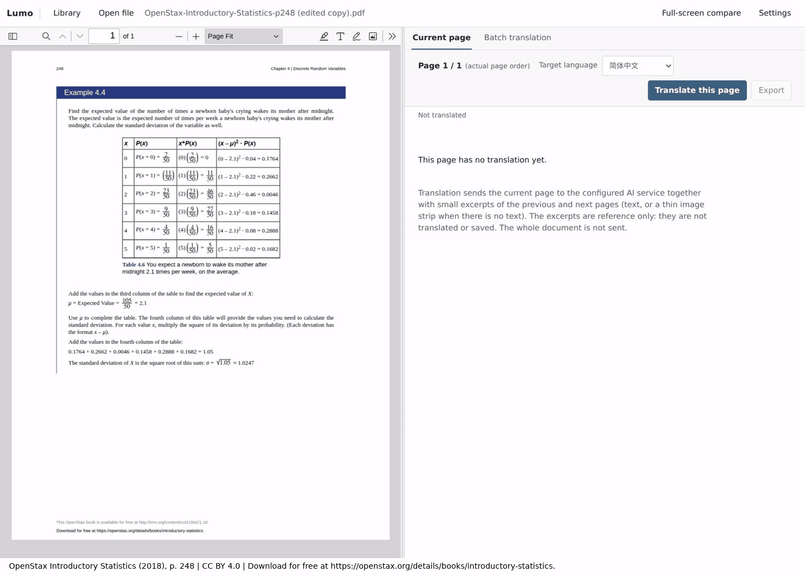

# Lumo 使用手册

[README](../README.zh-CN.md) · [English](manual.md)

## 概述

Lumo 是本地 PDF / EPUB 阅读器，用视觉模型翻译每一页：PDF 的一页，或 EPUB 屏幕上正在显示的那一页。每次请求还会附带相邻页的简短摘录以保持上下文连贯，摘录只作参考，不会被翻译或保存。每页译文会生成为独立 Typst 文档（标题、列表、表格、公式、图形、保留的图片或明确的占位说明），在模型能看清时保留原文的分栏、表格结构、颜色和粗斜体，保存在本地 SQLite 中并在应用内渲染。无法通过本地编译的文档会自动发回模型修正，一轮接一轮，直到编译通过或你取消（可能产生费用），页面面板会显示最近五轮的诊断与改动的行。PDF 没有可用目录时，Lumo 可以用同一视觉模型生成目录，并按目录选择批量翻译的页码范围；EPUB 提供由自身目录生成的目录面板，以及字号、字体、行距和主题的阅读设置。



录制使用当前版本，模型为 OpenAI GPT-6.1 Sol（推理强度 low），把一页从英文翻译为简体中文。Typst 源码随模型输出流式显示；随后 Lumo 校验、保存，并显示编译后的预览。生成阶段按 2–3 倍速播放，因此动图不代表真实耗时（这次从点击到出现预览约 26 秒）。[示例 PDF](assets/page-generation-demo.pdf) 即录制所用的页面。

该页是 [*Introductory Statistics*](https://openstax.org/details/books/introductory-statistics) 第 248 页，作者 Barbara Illowsky、Susan Dean（OpenStax，© 2018 Rice University），采用 [CC BY 4.0](https://creativecommons.org/licenses/by/4.0/) 许可，不在本项目 MIT 许可范围内。示例为单页摘录，并新增了署名页脚；译文由 Lumo 调用 GPT-6.1 Sol 生成，未获作者或 OpenStax 认可。

## 安装

从[最新 Release](https://github.com/oOSomnus/lumo/releases/latest) 下载适合你系统的文件，用 `SHA256SUMS` 校验后安装。无需额外安装任何东西：Bun、PDF.js、epub.js 和 Typst 运行时已内置，Windows 安装包还附带 WebView2 运行时。

| 系统 | 下载 | 要求 |
| --- | --- | --- |
| Windows x64 | `lumo-v<版本>-windows-x64-setup.exe` | Windows 10 1809 或更新 |
| Windows ARM64 | `lumo-v<版本>-windows-arm64-setup.exe` | Windows 11 |
| macOS Intel / Apple 芯片 | `lumo-v<版本>-macos-x64.dmg` / `lumo-v<版本>-macos-arm64.dmg` | macOS 13 或更新 |
| Linux x64 / ARM64 | `lumo-v<版本>-linux-<架构>.deb`、`.rpm` 或 `.AppImage` | 桌面会话、默认网页浏览器和 WebKitGTK 4.1（Ubuntu 22.04、Debian 12 或更新） |

- **Windows：** 运行安装程序（按当前用户安装，不需要管理员权限），从开始菜单启动 Lumo。在“设置 → 应用”中卸载。
- **macOS：** 打开 DMG，把 `Lumo.app` 拖到“应用程序”，从“应用程序”或启动台打开。删除 `Lumo.app` 即卸载。
- **Linux：** `sudo apt install ./lumo-v<版本>-linux-x64.deb` 或 `sudo dnf install ./lumo-v<版本>-linux-x64.rpm` 会把 Lumo 加入应用菜单，用包管理器卸载。AppImage 先 `chmod +x` 再直接运行，不会添加菜单项；系统没有 FUSE 时用 `--appimage-extract-and-run` 启动。删除该文件即卸载。

只有 Release 说明和 `SIGNING.txt` 明确写明时，安装包才经过签名；否则系统会给出提示：

- **Windows（未签名）：** SmartScreen 可能显示“Windows 已保护你的电脑”，选择 **更多信息 → 仍要运行**。由 Smart App Control 或组织策略管理的设备可能直接拒绝未签名应用，Lumo 无法改变这一点。
- **macOS（ad-hoc 签名，未公证）：** Gatekeeper 会阻止首次启动。按住 Control 点按 `Lumo.app` 选择 **打开**，或在 **系统设置 → 隐私与安全性** 中对这一个应用选择 **仍要打开**。无需关闭 Gatekeeper。

## 设置

设置中只有一个“AI 服务与模型”区域，之后是界面语言和数据工具。区域顶部的状态行会告诉你现在的情况：`已就绪：<服务> · <模型>`、尚未配置、配置已保存但还未完成（例如还缺凭证），或当前选择尚未保存。只有存在待保存内容时“保存”才是主按钮；已保存的配置完整后，“完成”会关闭对话框。

- **界面语言** — English 或简体中文。应用后页面会重新加载。界面语言与翻译目标语言相互独立。
- **Provider 与模型** — 只列出支持图像输入的模型。可用“刷新模型”从 provider 获取最新列表。
- **推理强度** — 可选，位于“高级设置”折叠区；已保存的值用到该区时（推理强度，或内置 provider 的 endpoint 覆盖）它会自动展开。默认不覆盖 provider 与模型自身的行为。可选等级来自所选模型：`minimal`、`low`、`medium`、`high`，模型支持时还有 `xhigh` 和 `max`。不支持推理的模型没有可选项。自定义 OpenAI-compatible endpoint 提供 `minimal` 到 `high`，但 endpoint 是否真正接受该设置只能由它自己决定；Lumo 不会为此发起付费探测。
- **Custom OpenAI-compatible** — 填写 endpoint、context window 和 max tokens。本地 endpoint 可以不使用 API key。
- **凭证** — 保存 API key，或完成 provider 的 OAuth 登录。移除凭证只在本地退出，不会在 provider 侧撤销。
- **Amazon Bedrock 与 Google Vertex** — 在应用内填写 API key（Bedrock bearer token 或 Google Cloud API key）。不提供 AWS profile、默认凭证链、Application Default Credentials、外部凭证文件或凭证链登录。
- **目标语言** — 译文语言与界面语言独立：简体中文、繁體中文、English、日本語、한국어、Deutsch、Français、Español。

设置保存在本地数据库中。Shell 中导出的 provider 密钥不会用于配置 provider。修改模型或推理强度不会自动改写已保存译文；需要重新生成页面才会应用新设置。每次翻译请求在开始时固定当时的 provider、模型与推理强度。打开或保存设置不会发起付费请求。

在保存服务、模型和凭证之前，“翻译本页”和批量面板的开始按钮会显示为“配置 AI 后翻译”：它们打开设置而不发送任何请求，关闭设置后页面、选页范围和语言保持原样。读取设置失败时，这些按钮会显示“重试读取配置”，而不是声称尚未配置。请求因认证或配置错误失败时会提供“打开 AI 设置”，原始错误码保留在“技术详情”中。重试保存草稿、导出和读取已保存译文都不需要 AI。

## 阅读与翻译

- Lumo 启动后先显示书架：每本书展示封面（PDF 首页或生成的 EPUB 封面卡片）、书名、进度和最近阅读时间。选择书籍会恢复上次保存的 PDF 页码或 EPUB 阅读位置与视图。顶栏的“书库”可返回书架且不结束当前会话，正在进行的翻译、草稿和未保存修改都会保留。
- PDF.js 官方 viewer 负责 PDF 渲染、目录、缩略图、文本选择、表单、批注与原生工具栏。EPUB 使用 epub.js，提供“目录”面板（书籍自带目录，覆盖在页面上）、上一页/下一页按钮、阅读设置（字号、字体、行距、主题）和文本选择。当前缩放或适合模式、旋转、滚动方式和跨页方式属于当前 PDF；EPUB 的阅读设置与位置属于当前书籍：翻页时保持不变，修改阅读设置或调整窗口大小时仍停在原文的同一位置，重新打开书籍、刷新页面或重启服务后仍会恢复。
- 专有名词与领域术语在每页首次出现时以括号附准确原文，例如 `费用（Expenses）`；同页再次出现只使用译名。识别效果取决于所选模型，已保存译文在重新生成前保持原有措辞。
- 版式与样式会在模型能看清的范围内贴近原文：分栏及相对宽度、表格的行列、空单元格与合并单元格、框内分组、背景底色、文字颜色以及局部的粗体和斜体，会用 Typst 原生的 grid、table 和文字样式重建，而不是用空格对齐。PDF 以页面图像为准；EPUB 只有其 XHTML 中存在的结构与行内样式。应用只内置部分字体，原文字体不同时会换成最接近的一种；颜色按图像目测近似；已保存的译文在重新生成前保持原有版式。
- 每个 PDF 页，或 EPUB 的每个屏幕页，会生成为一个独立 Typst 文档。模型可以使用标题、列表、表格、公式、图形和 `#image(...)` 保留提取出的图片；无法可靠表达的图形、图表或版式会显示带说明的占位。Typst 代码在本地渲染，不访问网络。新生成的文档如果无法通过本地编译，Lumo 会在保存前把失败源码和编译器诊断（行列从 1 开始，引用出错的那一行，并用 ⟦ 和 ⟧ 标出报错范围）发回模型，一轮接一轮地修正，直到编译通过或你点击“取消这一页”，轮数没有上限。模型以针对出错片段的精确文本替换作答，改动较大时才返回完整文档，由 Lumo 在本地套用。无法套用的回复（替换文本在源码中找不到或出现多次，或根本没有改动）会再追问并说明原因；只要连续的回复都没有改变源码，每次追问前依次等待 1、2、4、8、16 秒，之后固定等待 30 秒（回复一旦改变了源码，等待重新从 1 秒开始；取消会立即结束等待）；从第二轮起，请求还会附上上一轮回复改了什么、或为什么被拒绝，让模型不再重复无效的改法。因为轮数不设上限，模型始终修不好的页面会一直产生 AI 调用直到你取消，可能产生费用。修复期间，译文面板会列出最近五轮（较早的轮次只提示被省略了几轮，修复本身不会因此缩短）：发给模型的编译诊断、回复是替换片段还是重写整篇、改动前后的行，以及修复后能否通过编译；源码通过编译之前不会写入数据库。取消，或请求失败（网络、认证、服务商错误或超时）时，页面会作为未保存草稿保留，旧译文不会被覆盖；草稿可以编辑、导出或丢弃，期间该页不能翻译或重新生成。“重试保存”和保存手动编辑会重新编译草稿，不会调用模型；“修复 Typst”（已有修复记录时为“继续修复”）会从最新草稿开始新一次修复，只有编译器仍然拒绝草稿时才调用模型，之后同样一轮接一轮直到编译通过或你取消，可能再次产生费用。
- **相邻页上下文** — 句子常常跨页，因此每次请求还会附带上一页末尾和下一页开头的简短摘录（各最多 2000 个字符的文字；PDF 页没有文字层时改用一条窄图像带）。摘录只作参考：模型被告知不要翻译它们，也只保存当前页的译文。相邻页读取失败时，当前页仍会翻译，只是上下文更少，页面面板会提示。修复轮次不会再发送页面源内容和摘录。
- **预览与源码** — 右侧可在渲染结果与可编辑的 Typst 源码之间切换。预览始终铺满右栏的可用宽度，整页随之按比例缩放。只读显示的 Typst 源码带语法高亮：页面生成时“实时 Typst 源码”中正在到来的内容、“源码”视图，以及修复轮次中改动前后的行；高亮器随应用打包，不需要网络，编辑框仍是纯文本。页面生成或修复期间，右栏显示正在到来的 Typst 源码或当前修复草稿，而不是预览；上一次保存的译文仍在存储中，只有新结果保存成功才会被替换，运行结束而没有草稿时会重新显示。源码编辑器可保存或放弃修改。译文工具栏的“导出”可把当前页导出为 Typst，或把当前语言下已保存的全部内容导出为 ZIP，并打包图片资源。编辑不会触发 AI 请求；保存后的源码会替换该页的生成结果。
- **分栏布局** — 窗口宽度不小于 1,024 px 时，窗格上方的按钮可在“仅左侧”“仅右侧”“均分”“左侧优先”（60/40）和“右侧优先”（40/60）之间切换。两个窗格始终保持挂载，因此被隐藏的一侧仍保留 PDF 页码与缩放、表单修改、进行中的翻译和未保存的 Typst 草稿，书籍也不会重新加载。两栏之间的分隔条可以拖动，或用方向键、Home、End 在 20% 到 80% 之间调整，Enter 恢复 50/50，按钮会随之更新。布局不会保存，刷新后从均分开始。更窄的窗口改用“原文”“译文”“批量”三个标签页。
- **翻页快捷键** — 无论焦点在哪里，左右方向键都会翻页：PDF.js viewer、EPUB（包括章节内部）、译文及其源码与预览、批量面板。EPUB 按屏幕页翻页，并继续进入下一节或上一节。在文本框、下拉框和滑块中、在分隔条上、在对话框中、编辑批注时、输入法组字时，以及按住 Shift、Ctrl、Alt 或 Meta 时，方向键保持各自原有的作用。在书的第一页或最后一页不会发生任何事。
- **文本选择** — 在 EPUB 中选中任意非空文字后，译文工具栏的主按钮变为“翻译选区”，工具栏下方显示所选文字和“清除选区”按钮；窄屏下请切换到“译文”标签页查看。所选内容作为独立译文单元单独保存，不覆盖页面译文，也不包含在“导出全部译文”中；大小上限与一个屏幕页相同（XHTML 不超过 100,000 个字符）。在 PDF.js 中选中的文字属于 PDF.js 自带的选择，Lumo 不会翻译它；PDF 按整页翻译。
- **当前页译文** — 翻译、查看流式输出，或把当前页的 Typst 文档导出（含外部图片时会打包为 `.zip`）。EPUB 的当前页是屏幕上正在显示的那一页；页面定位完成前翻译按钮不可用。页面已有译文后，主按钮变为“重新生成译文”；确认后会使用当前设置再次调用 AI。旧译文仍保存在存储中，只有新译文保存成功后才被替换；新版本生成或修复期间面板显示的是正在到来的源码，取消后留下的草稿可以丢弃，丢弃后旧译文重新显示。
- **空页面与错误** — 没有译文的页面只显示一行提示和简短的隐私说明，完整的发送范围收在“发送范围”折叠区；错误先给出通俗的说明，错误码和原始细节收在“技术详情”里。
- **批量翻译** — 面板从选择一路排到开始。先选择方式：PDF 为“按目录”或“按页码”，EPUB 为“按目录”（默认）或“按章节编号”。再选择范围：PDF 页用页码表达式或快捷按钮，或勾选目录项；EPUB 勾选目录项（每项选中其整节，指向同一节的目录项会重叠）或使用章节快捷按钮。在发送任何内容之前，摘要会说明将发生什么：对 PDF，已选多少页、因已有任务或未保存草稿而跳过多少页、因已有译文而跳过多少页、将翻译多少页（即开始按钮上的数字，旁边附费用提示）；对 EPUB，已选多少节。更改方式或目标语言不会丢失选好的范围。对 EPUB，“未翻译节”会勾选在当前窗口大小和阅读设置下仍有屏幕页没有已存译文的每一节，因此只翻译了一部分、或只在其他版面下翻译过的节会被再次勾选；它要先定位整本书的页面，需要一点时间，可用“停止全部”结束。Lumo 会按当前窗口大小和阅读设置把选中的章节切成屏幕页，再逐页单独翻译，已保存的页会跳过；最多 3 个单元并行。“停止全部”只在有任务运行或排队时出现，“重试本书失败任务（所有语言）”只在有任务失败后出现；AI 尚未配置时开始按钮显示为“配置 AI 后翻译”。重新生成已保存页需要明确选择，并会产生费用。
- **触屏与窄 viewer** — 在触屏上，按钮、下拉框和文本框至少 44 px 高（文本框和下拉框在宽度不足 1,024 px 的窗口中同样如此），PDF 工具栏使用 PDF.js 的触屏布局。viewer 宽度约 690 px 及以下时，批注工具会收进“阅读工具”菜单，约 360 px 及以下时搜索和缩放也会收进去；Esc 关闭菜单并把焦点还给它的按钮。
- **EPUB 页** — 以重排后的一个屏幕页为翻译单位：Lumo 发送恰好可见范围的 XHTML（其中的图片已改为稳定的资源路径）和提取的图片预览，并把译文连同该范围（EPUB CFI）一起保存；阅读位置同样以 EPUB CFI 保存。窗口大小、字号、字体和行距决定每页的起止，因此在其他版面下保存的译文仍留在数据库中，但不会显示在新的页上；批量翻译在开始时固定版面。可解码的图片会保留为图片资源；脚本、远程资源和不受支持的媒体不会加载。页面引用的每个图片资源都会按路径告知模型，并标明是否附有预览，因此没有预览的图片仍可保留在译文中。头部声明超过 4000 万像素（宽 × 高）的图片不会被解码：这样大的 PNG 或 GIF 仍作为图片资源保留，但发送时没有预览；这样大的 WebP 会从页面中省略；相邻页中最近的图片这样大时，按无法读取的上下文处理。JPEG 预览直接使用原文件，无需解码。只含内联 SVG 绘图的屏幕页没有可发送的文字或图片，阅读器会提示并保持“翻译本页”不可用。固定版式 EPUB 没有阅读设置。
- **按目录选择** — PDF 没有可用目录时，批量面板可以用当前视觉模型生成目录。它会逐页发送页面图像和文字，调用次数等于页数，可能产生费用。生成的目录保存在 `reader.sqlite`，再次打开文档时复用；不会修改 PDF 字节，也不会写入 PDF.js 侧栏。目录生成仅用于 PDF；EPUB 直接使用包内目录。勾选章或节会把其完整物理页范围加入同一个选页集合。父章节包括全部子章节；同页开始的章节可能重叠；翻译仍以完整 PDF 页为单位。生成目录是需要核对的推断结果，翻译前请先检查。PDF 有可用原生目录时会直接显示原生目录。
- 译文持久化到 SQLite；再次打开同一页优先显示已保存结果。“导出全部译文”会把已保存的页面源码导出为 ZIP，内含逐页 `.typ` 文件和图片资源：PDF 为 `p<页码>-<语言>.typ`，EPUB 为 `<序号>-s<章节>-<语言>.typ`，序号按阅读顺序给已保存的屏幕页编号；选择译文不包含在该文件中。
- 修改表单或批注后，“保存修改副本”会生成新文档并保留原件；有未保存修改时会阻止产生新译文。
- **文件上限** — PDF 和 EPUB 文件的总大小不设应用层上限；大文件仍受可用内存和磁盘空间限制。EPUB 包最多包含 20,000 个条目，其 container 与包（OPF）XML 文件各自最多 2,097,152 个字符（按 JavaScript 字符串长度计数，不是字节数）。

## 桌面应用与独立服务

安装后的应用是一个小窗口，它启动随包附带的服务 `lumo-server`，并在窗口打开期间保持其运行。`lumo-server` 是编译后的 Bun 程序，内嵌服务端、前端、PDF.js、epub.js、JSZip 以及 Typst 编译器/渲染器和字体；机器上不需要 `node_modules`、`vendor/` 或 Bun。阅读和翻译仍在系统默认浏览器中进行，窗口本身不加载阅读界面。

窗口从上到下显示：名称和版本；文字状态（正在启动、正在运行、正在停止、未在运行）；不含访问码的本地地址；**打开 WebUI** 与**复制访问链接**；通俗易懂的最近活动；**更多日志与详情**（最近 200 条、数据目录，失败后还有失败码）；以及**退出 Lumo**。只有服务运行时才能打开和复制。**复制访问链接**复制的是含本次访问码的完整链接：它只在本机有效，请勿分享。服务就绪后，窗口使用书库中保存的界面语言；此前以及数据库无法打开时，使用系统语言（中文或英文）。

- **失败** — 服务无法启动或意外停止时，窗口保持打开、撤下地址，并显示固定原因和**重试启动**。每次重试都会启动新的服务，使用新的端口和访问码，因此上一次运行的链接随即失效。45 秒内未就绪视为失败。
- **退出** — 关闭窗口、应用菜单的“退出”和**退出 Lumo**行为一致。服务运行时 Lumo 会先请你确认，因为这会停止服务并中断正在进行的翻译；随后等待服务写完数据（最长 35 秒，超时则强制结束并给出警告），窗口才关闭。macOS 上关闭最后一个窗口同样会退出，不留后台进程。窗口进程若意外消失，服务会自行发现并退出。
- **再次启动** — 再次启动 Lumo 只会把已有窗口带到前台。
- **活动日志** — 只保存在内存中（最近 200 条），不写入磁盘；内容是固定的提示语，不含访问码、密钥、模型输入或服务商的错误文本。

为本机构建安装包，或只构建独立服务：

```bash
bun run build            # 安装包位于 src-tauri/target/<triple>/release/bundle/
bun run build:server     # dist/sidecar/lumo-server-<triple>
LUMO_DATA_DIR=/absolute/path ./dist/sidecar/lumo-server-<triple>
```

不带参数手动启动时，服务会像源码模式一样打印浏览器地址。`--desktop` 是窗口使用的私有协议（stdout 上的 JSON 事件和 stdin 上的一条停止命令），不供手动使用。

## 从源码构建

要求 Bun 1.4.2 或更新版本。桌面窗口还需要 Rust 1.90 或更新版本，以及所在系统的 [Tauri 系统依赖](https://tauri.app/start/prerequisites/)。

```bash
bun install
bun run dev          # 构建服务并打开桌面窗口
bun run dev:server   # 仅运行服务，不需要 Rust
```

`bun run dev:server` 会打印带访问码的地址，例如 `http://127.0.0.1:12345/?token=...`。服务只监听 `127.0.0.1`，请在同一台机器的浏览器中打开该地址；桌面窗口的“打开 WebUI”按钮效果相同。在“设置”中（第一次点击“翻译”时会自动为你打开）选择支持图像输入的模型，再配置 API key 或 OAuth 登录。

首次运行会把固定版本的 PDF.js viewer 下载到 `vendor/pdfjs/`，并在 `vendor/typst/` 准备 Typst 运行时与字体；压缩包由脚本自行解压，无需系统安装 `unzip`。epub.js 与 JSZip 从 `node_modules` 复制。

## 数据与安全

所有系统的默认数据目录都是 `${XDG_DATA_HOME:-~/.local/share}/lumo`：未设置 `XDG_DATA_HOME` 时，macOS 和 Linux 为 `~/.local/share/lumo`，Windows 为 `%USERPROFILE%\.local\share\lumo`。安装、升级和卸载应用都不会触碰它。请在启动 Lumo 的环境中用 `LUMO_DATA_DIR` 指定绝对路径：

```bash
LUMO_DATA_DIR=/absolute/path/to/lumo-data bun run dev:server
```

| 文件 | 内容 |
| --- | --- |
| `reader.sqlite` | PDF 与 EPUB 原始字节、书库、阅读进度与每本书的阅读视图（页码或 EPUB CFI）、生成的 PDF 目录、界面语言、AI 配置、译文和编辑后的 Typst 源码。 |
| `ai-credentials.sqlite` | API key / OAuth 凭证。 |

- macOS 和 Linux 上目录权限为 `0700`、两个数据库文件权限为 `0600`；Windows 上沿用你的用户配置文件目录的访问控制。
- AI 凭证在本机明文存储，未加密；不会通过 API 返回，也不会写进日志。备份前请按需保护。
- 多个实例可以共用同一数据目录：各自取得不同端口，写入通过 SQLite 事务串行化，同一条记录以最后提交为准；界面不会实时同步其他窗口。
- 备份前先关闭所有使用该目录的实例；WAL 文件（`reader.sqlite-wal`、`-shm`）是数据库的一部分，不要只复制主文件。
- 删除书库条目会同时删除该 PDF 的全部译文。退出登录只删除本地凭证，不会在 provider 侧撤销；旧备份仍可能包含该凭证。
- 应用只接受当前存储格式。较旧或不受支持的数据库会在启动时被拒绝，原文件保持不变。
- 页面只由本机 `127.0.0.1` 提供；访问码在启动时随机生成，只出现在终端打印的 URL 和 API 的 Bearer 头中。桌面窗口从不显示访问码：**打开 WebUI** 与**复制访问链接**由启动器从内存中附上。API 校验 Host、Origin、`Sec-Fetch-Site` 和 Bearer token，并拒绝跨源预检、跨站写请求和压缩请求体。
- 翻译请求会发送当前页（PDF 为页面图像和文字，EPUB 为可见范围的 XHTML 与图片预览）以及上文所述的简短相邻摘录；摘录不会被保存，也不会发送整本文档。PDF 中的链接/表单不执行页面脚本；EPUB 内容在沙箱中运行且禁用脚本，远程资源被阻止。Typst 渲染只输出自身 SVG，不会执行文档 HTML 或脚本。除配置的 AI endpoint 外，应用不向其他第三方发送数据；登录时浏览器直连 provider 的授权页面。

[返回 README](../README.zh-CN.md)
